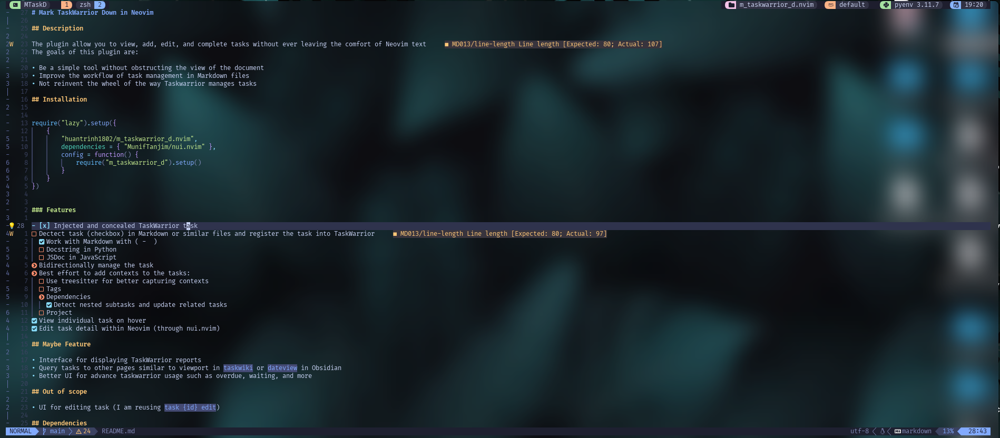
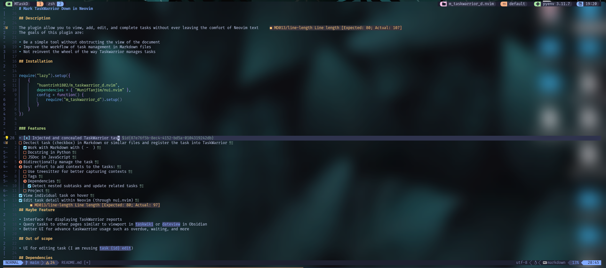
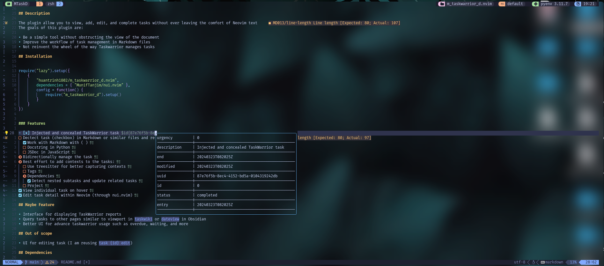
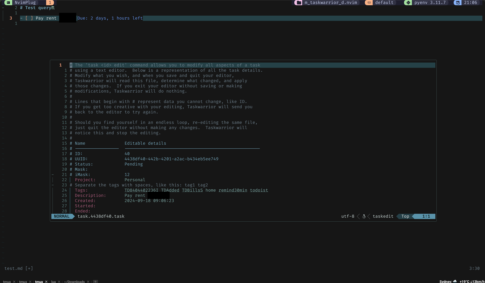
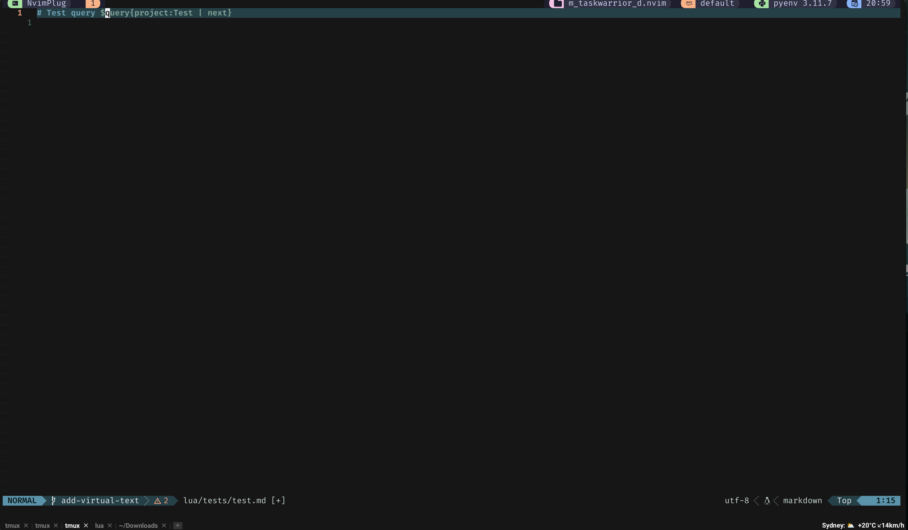
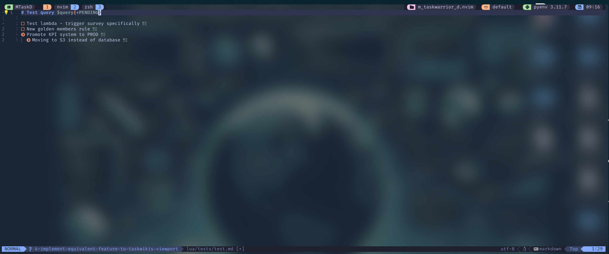
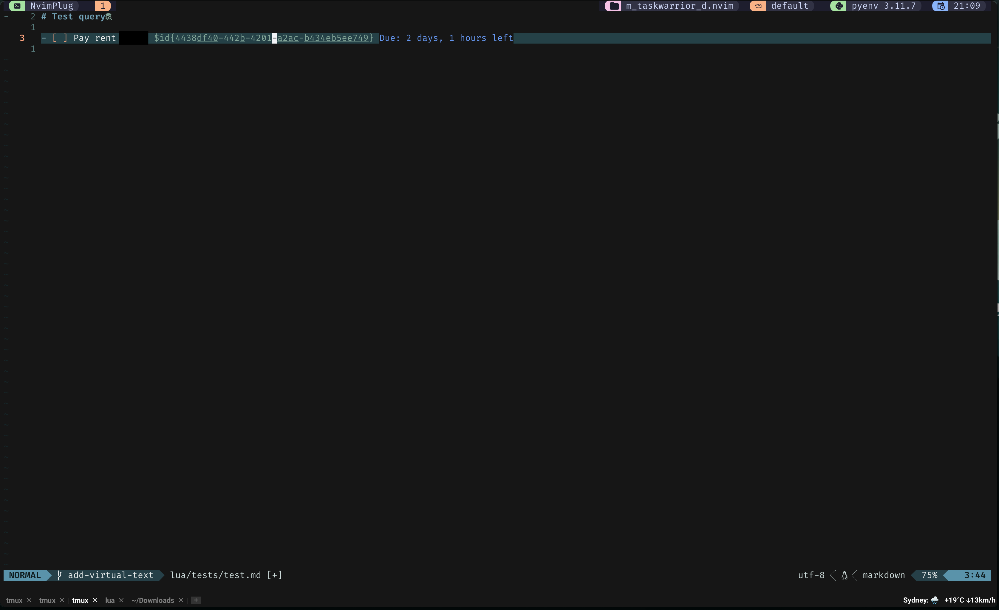

# Mark Taskwarrior Down in Neovim

## Description

The plugin allow you to view, add, edit, and complete tasks without ever leaving the comfort of Neovim text
The goals of this plugin are:

- Be a simple tool without obstructing the view of the document
- Improve the workflow of task management in Markdown files
- Not reinvent the wheel of the way Taskwarrior manages tasks

## Screenshots

### Sync Tasks

#### Before syncing



#### After syncing



### Quick View



### Edit Task



### QueryView

#### Before run TWQueryTasks



#### After run TWQueryTasks



#### Virtual Text for Due/Scheduled task



## Features

- [x] Injected and concealed Taskwarrior task
- [x] Detect task (checkbox) in Markdown or similar files and register the task into Taskwarrior
  - [x] Work with Markdown with ( - [ ])
  - [ ] Docstring in Python
  - [ ] JSDoc in JavaScript
- [x] Bidirectionally manage the task
- [>] Best effort to add contexts to the tasks:
  - [ ] Use treesitter for better capturing contexts
  - [x] Tags
  - [x] Dependencies
    - [x] Detect nested subtasks and update related tasks
    - [x] Render dependencies with query view
  - [x] Project
- [x] View individual task on hover
- [x] Edit task detail within Neovim (through nui.nvim)
- [x] `Query View` similar to `dateview` in Obsidian or `Viewport` in Taskwiki
- [x] Virtual text for due and scheduled tasks
- [x] Inline Taskwarrior attribute parsing

## Inline Taskwarrior Attributes

You can include Taskwarrior attributes directly in your markdown task text. The plugin will parse and apply them to the task in Taskwarrior, then display only the clean description in your markdown.

**Supported attributes:**
- **Projects**: `project:home`, `project:work.coding`
- **Tags**: `+urgent`, `+shopping`, `-someday`
- **Due dates**: `due:tomorrow`, `due:2024-12-31`, `due:eom`
- **Scheduled dates**: `scheduled:monday`, `scheduled:2024-12-25`
- **Priority**: `priority:H`, `priority:M`, `priority:L`
- **Any Taskwarrior attribute**: `wait:1week`, `until:eoy`, `depends:UUID`, etc.

**Example:**

Before sync:
```markdown
- [ ] Buy groceries project:home +shopping due:friday
```

After `:TWSyncTasks`:
```markdown
- [ ] Buy groceries $id{uuid-here}
```

The task in Taskwarrior will have:
- Description: `Buy groceries`
- Project: `home`
- Tags: `shopping`
- Due: `friday`

This allows you to quickly capture tasks with context inline, while keeping your markdown clean and readable.

## Maybe Feature

- Interface for displaying Taskwarrior reports
- Query tasks to other pages similar to viewport in `taskwiki` or `dateview` in Obsidian
- Better UI for advance Taskwarrior usage such as overdue, waiting, and more

## Out of scope

- UI for editing task (I am reusing `task {id} edit`)

## Dependencies

- [Taskwarrior](https://taskwarrior.org/) (pre3.0) (hard required)
  - Have not tested v3.0 but it may have a breaking change due to its move to SQLite as the main storage engine
- [nui.nvim](https://github.com/MunifTanjim/nui.nvim)
  - For all UIs in the plugin
- [yq](https://github.com/mikefarah/yq) (mikefarah/yq, the Go binary) (hard required for Frontmatter Task Notes)
  - Only needed if you use `:TWSyncNote` / the frontmatter task-note workflow described below
  - The Python `kislyuk/yq` wrapper is not supported (different flags/behavior)

## Work Well With

- [mkdnflow.nvim](https://github.com/jakewvincent/mkdnflow.nvim)
  - This plugin provides comprehensive utilities for Markdown files
  - Caveat: you need to disable/not use toggle checkbox from this plugin
- [obsidian.nvim](https://github.com/epwalsh/obsidian.nvim/tree/main)
  - If you use Obsidian for note taking, this plugin is highly recommended
  - This plugin provides some nice concealment and utilities for Obsidian
- [markdown.nvim](https://github.com/MeanderingProgrammer/markdown.nvim)
  - Plugin to improve viewing Markdown files in Neovim
  - Tips: if you use `markdown.nvim` and `obsidan.nvim`, you should disable `obsidian.nvim`'s UI configurations

## Similar To

- [taskwiki](https://github.com/tools-life/taskwiki)
  - This plugin provides better utilities for managing tasks in Markdown files with Taskwarrior
  - Reasons I decided not to use this plugin:
    - Rely on [Vimwiki](https://github.com/vimwiki/vimwiki), which has wonky interactions with `obsidian.nvim` and `mkdnflow.nvim` (due to special filetype `vimwiki`)
    - Disclaimer: there may be a way to configure to make Vimwiki and markdown plugins to work together but I decided to write m_taskwarrior_d.nvim

## Installation

```lua
{
    "huantrinh1802/m_taskwarrior_d.nvim",
    version = "*",
    dependencies = { "MunifTanjim/nui.nvim" },
    config = function()
    -- Require
      require("m_taskwarrior_d").setup()
    -- Optional
      vim.api.nvim_set_keymap("n", "<leader>te", "<cmd>TWEditTask<cr>", { desc = "TaskWarrior Edit", noremap = true, silent = true })
      vim.api.nvim_set_keymap("n", "<leader>tv", "<cmd>TWView<cr>", { noremap = true, silent = true })
      vim.api.nvim_set_keymap("n", "<leader>tu", "<cmd>TWUpdateCurrent<cr>", { noremap = true, silent = true })
      vim.api.nvim_set_keymap("n", "<leader>ts", "<cmd>TWSyncTasks<cr>", { noremap = true, silent = true })
      vim.api.nvim_set_keymap(
        "n",
        "<c-space>",
        "<cmd>TWToggle<cr>",
        { silent = true }
      )
    -- Be caution: it may be slow to open large files, because it scan the whole buffer
      vim.api.nvim_create_autocmd({ "BufEnter", "BufWritePre" }, {
        group = vim.api.nvim_create_augroup("TWTask", { clear = true }),
        pattern = "*.md,*.markdown", -- Pattern to match Markdown files
        callback = function()
          vim.cmd('TWBufQueryTasks')
          vim.cmd('TWSyncTasks')
        end,
      })
    end,
  },
```

## Usage

- Default configurations:

```lua
{
  -- The order of toggling task statuses
  task_statuses = { " ", ">", "x", "~" },
  -- The mapping between status and symbol in checkbox
  status_map = { [" "] = "pending", [">"] = "active", ["x"] = "completed", ["~"] = "deleted" },
  -- List marker patterns (lua/vim regex) for checkboxes
  list_pattern = { lua = "[%-%*%+]", vim = "[\\-\\*\\+]" },
  -- The checkbox prefix and suffix
  checkbox_prefix = "[",
  checkbox_suffix = "]",
  -- The default list symbol
  default_list_symbol = "-",
  -- Comments pattern prefix and suffix
  -- This is extremely useful for viewing the note in any Makrdown previewers (i.e. Obsidian app) if you set   
  -- - comment_prefix = "<!--",
  -- - comment_suffix = "-->",
  comment_prefix = "",
  comment_suffix = "",
  -- The file pattern to trigger the conceal
  file_patterns = { "*.md", "*.markdown" },
  display_due_or_scheduled = true,
  -- Frontmatter task-note mode (see "Frontmatter Task Notes" below)
  -- The frontmatter key that must be `true` for a file to be treated as a linked task note
  frontmatter_indicator_key = "tw_task",
  -- The frontmatter key that stores the Taskwarrior task's UUID
  frontmatter_uuid_key = "uuid",
  -- The frontmatter key used as the task description, falling back to the filename
  frontmatter_title_key = "title",
  -- The yq binary to shell out to for parsing frontmatter YAML
  yq_bin = "yq"
  -- More configurations will be added in the future
}
```

### Statuses

- `pending`: corresponding to `pending` status
- `active`: has `active` attribute 
- `completed`: corresponding to `completed` status
- `deleted`: corresponding to `deleted` status

If you are using `obsidian.nvim`, you can use the following configuration:

```lua
{
  ui = {
    checkboxes = {
      [" "] = { char = "󰄱", hl_group = "ObsidianTodo" },
      ["x"] = { char = "", hl_group = "ObsidianDone" },
      [">"] = { char = "", hl_group = "ObsidianRightArrow" },
      ["~"] = { char = "󰰱", hl_group = "ObsidianTilde" },
               },
    hl_groups = {
      ObsidianTodo = { bold = true, fg = "#f78c6c" },
      ObsidianDone = { bold = true, fg = "#89ddff" },
      ObsidianRightArrow = { bold = true, fg = "#f78c6c" },
      ObsidianTilde = { bold = true, fg = "#ff5370" },
      ObsidianBullet = { bold = true, fg = "#89ddff" },
      ObsidianRefText = { underline = true, fg = "#008080" },
      ObsidianExtLinkIcon = { fg = "#008080" },
      ObsidianTag = { italic = true, fg = "#89ddff" },
      ObsidianHighlightText = { bg = "#75662e" },
    },
  },
}
```

If you are using `markdown.nvim`, you can set the following configuration:

```lua
  {
    "MeanderingProgrammer/markdown.nvim",
    name = "render-markdown", -- Only needed if you have another plugin named markdown.nvim
    dependencies = { "nvim-treesitter/nvim-treesitter" },
    config = function()
      require("render-markdown").setup({
        checkbox = {
          enabled = true,
          checked = {
            -- Replaces '[x]' of 'task_list_marker_checked'
            icon = " ",
            -- Highligh for the checked icon
            highlight = "RenderMarkdownChecked",
          },
          custom = {
            started = { raw = "[>]", rendered = " ", highlight = "@markup.raw" },
            deleted = { raw = "[~]", rendered = " ", highlight = "@markup.raw" },
          },
        },
      })
    end,
  },
```

### Commands

- `:TWToggle`: toggle status of task
  - If the task is registered in Taskwarrior, it also checks the parent task (if any) to determine the final status and apply it. The logic is as follows:
    - If there are any started tasks, it returns `active`.
    - If there are pending tasks but no started tasks, it returns `pending`.
    - If there are completed tasks, it returns `completed`.
    - If they are all deleted tasks, it returns `deleted`.
    - If none of the above conditions are met, it returns "unknown" (or any other default value).
- `:TWSyncTasks`: traverse the current buffer and sync all tasks
  - Parses inline Taskwarrior attributes (e.g., `project:home`, `+tag`, `due:tomorrow`) and applies them to tasks
  - There are a few scenarios, that may happen:
    - If the task is not in Taskwarrior, and doesn't have UUID, it will add the task to Taskwarrior and add the UUID to the buffer
    - If the task is not in Taskwarrior, but have UUID in the follow format `$id{uuid}` then it will add the task to TaskWarrior and update the UUID
    - If the task is in Taskwarrior:
      - If nothing changes, nothing get updated
      - If the descriptions are different, it will update the description in the buffer as I prefer Taskwarrior to be source of truth
  - If any headers have QueryView, the tasks in the scope of the headers (surrounded by 2 empty lines, according to Markdown) will be modified with such query, except for `status:*`.
    - For example,

    ```markdown
      # Project pending tasks for project A $query{status:pending project:A}
    ```

    - Any tasks under the header will be assigned to project A
  - With a bang, `:TWSyncTasks!`, only checkbox lines that are already tracked (have a `$id{...}`) are synced; untracked checkbox lines are left alone instead of being auto-added as new Taskwarrior tasks. Works with `:TWSyncBulk!` too.
- `:TWSyncCurrent`: similar to `TWSyncTasks` but only sync the current task. Work with normal and visual mode
- `:TWSyncBulk`: similar to `TWSyncTasks` but only sync the selected tasks in visual mode
- `:TWSyncNote`: sync the current buffer's frontmatter to a single Taskwarrior task (see "Frontmatter Task Notes" below), then sync any already-tracked checkbox tasks in the body (same as `:TWSyncTasks!`). No-op if the buffer isn't an opted-in task note.
- `:TWUpdateCurrent`: quickly update the description of the task so you don't have to use the edit command
- `:TWEditTask`: toggle a float window, which can edit the task.
  - Using the `task {id} edit` behind the scene
  - It will update the description in the buffer if you edited it in the popup
- `:TWView`: a quick view of more details of the task
  - It is focusable so you can copy texts from their
  - It will be dismissed once the cursor moves or reenter the buffer
- `:TWRunWithCurrent`: extract the current UUID, and run a Taskwarrior command against it
  - `:TWRunWithCurrent` (no args) opens an input field
  - `:TWRunWithCurrent {args}` runs directly as `task {uuid} {args}`
- `:TWRun`: there are two ways to use this command:
  - `:TWRun` (no args) opens an input field and runs `task {input}`
  - `:TWRun {args}` runs directly as `task {args}`
      - If the command has `add`, `del`, `mod` or `purge`, the output will print out only
      - Otherwise, the output will be put into a float, focusable window under the cursor. It is dismissed once the cursor moves or reenter the buffer
- `:TWFocusFloat`: switch the focus to a floating window (or hover, triggered by `TWView`, `TWRunWithCurrent`, and `TWRun`).
- `:TWEditSavedQueries`: display a buffer with list of saved queries. Each query should be a valid Taskwarrior query that can be run with `task {query}`
  - Each query can be edited and saved as you could with any buffer
  - The format is `[name of the query] | [filters] | [report]`, don't include `[` and `]` in your actual query
  - `q` or `:q` will close thu buffer without saving any changes
  - `:wq` or `w` will save and close the buffer
  - The file is saved in `vim.fn.stdpath("data").."m_taskwarrior_d.nvim"`
- `:TWSavedQueries`: will prompt a menu with the list of all saved queries, after an item is selected, a floating window will open with the output of `task {query}`
- `:TWRunBulk`: similar to `TWRun`, but run commands on selected tasks in visual mode
  - `:TWRunBulk` (no args) opens an input field
  - `:TWRunBulk {args}` runs directly against each selected task
- `:TWQueryTasks`: similar to `taskwiki`'s viewport, render the output of the `task {query}` as the list of tasks
  - Nested tasks are supported
  - In-sync with where it is first created
- `:TWBufQueryTasks`: similar to `TWQueryTasks`, but this will scan the current buffer and run all the queries in the current buffer
- `:TWTaskScratch`: prompt a menu with the list of all saved queries, after an item is selected, a split window will open and render out the tasks of the selected query
  - What it does is open a temporary file in `vim.fn.stdpath("data").."/m_taskwarrior_d.md"`, append the selected query and run `TWQueryTasks` on it
  - There are two additional commands to use with the scratch window:
    - `:TWScratchShow`: to show the hidden scratch window
    - `:TWScratchHide`: to hide the scratch window
- `:TWShowDueOrScheduled`: display due or scheduled tasks as virtual text end of line
- `:TWShowDueOrScheduledCurrent`: display due or scheduled tasks as virtual text end of line for current line


### Task Dependencies

- Nested checkboxes are depended on the parent checkbox

```markdown
- [ ] Task 1 # Has 1.1, 1.2, 1.2.1 as dependencies $id{d4452942-ac6e-46c6-b110-001ea731c676}
  - [ ] Task 1.1 # Has none $id{53389315-5975-4db9-a796-1cd2514e1be1}
  - [ ] Task 1.2 # Has 1.2.1 as dependency $id{ea843624-37c0-429c-89c6-19f661149668}
    - [ ] Task 1.2.1 $id{792e57a6-ea55-4c9e-ab32-9e840d66088d}
```

### QueryView

```markdown
# Tasks that are in pending of project A $query{status:pending project:A}
```

### Frontmatter Task Notes

An alternative, additive workflow for one-file-per-task setups (Obsidian-style PKM/PM vaults): instead of a checkbox line, a whole Markdown file's YAML frontmatter maps to a single Taskwarrior task. Requires [`yq`](https://github.com/mikefarah/yq) to be installed (see Dependencies above).

A file is only synced if its frontmatter has `tw_task: true` (configurable via `frontmatter_indicator_key`) — frontmatter on unrelated notes is never touched.

```markdown
---
tw_task: true
title: Write the quarterly report
project: work.reports
tags: [urgent, writing]
priority: H
---

Notes go here — the body is never synced.
```

Run `:TWSyncNote` on the file:

- If there's no `uuid:` key yet (or the one there doesn't match a real task), a new Taskwarrior task is created and a `uuid:` line is written back into the frontmatter in place, without reformatting the rest of it.
- Every other scalar key becomes a `task <uuid> modify key:value` (e.g. `project:work.reports`, `priority:H`).
- A `tags:` list becomes `+tag` per element. Other list-valued keys are skipped with a warning — no clean Taskwarrior equivalent.
- `title` (configurable via `frontmatter_title_key`) is the task's description; if omitted, the filename (minus extension) is used instead. Unlike checkbox-line sync, frontmatter is authoritative here — the description is pushed on every sync, overwriting whatever Taskwarrior has.
- Any checkbox lines in the body are synced too, but only if already tracked (`$id{...}`) — same as `:TWSyncTasks!`, an untracked checklist item in the body is left alone rather than becoming a new orphan task.

Vault-wide/directory bulk sync isn't supported yet — `:TWSyncNote` operates on the current buffer.

## License

This plugin is licensed under the MIT License. See the LICENSE file for more
 details.

## Issues

If you encounter any issues or have suggestions for improvements, please open
 an issue on the GitHub repository.

## Contributors

- Ben Trinh <huantrinh1802@gmail.com>

[](https://ko-fi.com/W7W4VVT9J)

Thank you for using the Neovim Lua Plugin! If you find it helpful, please consider
 starring the repository.
